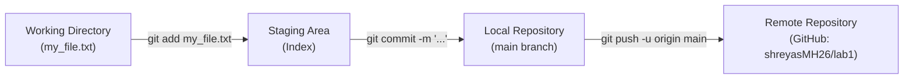

# College Lab Activity — Experiment 1
## Git Setup, Basic Commands, Staging, and Pushing to Remote


---

## 📋 Experiment Overview
- **Course**: Software Engineering & Version Control Lab
- **Experiment No**: 1
- **Title**: Setting Up, Basic Commands, and Pushing to Remote
- **Student**: Shreyas M H ([@shreyasMH26](https://github.com/shreyasMH26))
- **Objective**: Initialize a new Git repository in a directory, create a new file, add it to the staging area, commit the changes with an appropriate commit message, and push it to a remote GitHub repository.

---

## 🧠 Git Lifecycle Architecture



---

## 🛠️ Step-by-Step Execution Log (Lab Manual Compliance)

### Step 1 & 2: Create directory for Lab 1
```bash
mkdir lab1
```

### Step 3: Navigate into the directory
```bash
cd lab1
```

### Step 4: Initialize Git Repository
```bash
git init
```
*Creates the hidden `.git` folder tracking snapshots and version history.*

### Step 5: Create a new file
```bash
echo "This is my very first Git experiment." > my_file.txt
```
*Content verified in `my_file.txt`.*

### Step 6: Add file to the Staging Area
```bash
git add my_file.txt
```
*Prepares the file in the staging index for snapshotting.*

### Step 7: Commit the changes
```bash
git commit -m "Add a new file called my_file.txt"
```
*Takes a permanent snapshot with a descriptive historical message.*

### Step 8: Connect to Remote Cloud (GitHub)
```bash
git remote add origin https://github.com/shreyasMH26/lab1.git
```

### Step 9: Push to GitHub
```bash
git push -u origin main
```
*Uploads local commits and sets the upstream tracking branch.*

---

## 🎨 Creative Enhancement: Interactive Terminal Showcase

To make this lab stand out, an interactive Python showcase `terminal_banner.py` was created:
- Displays colorful ASCII art banner and student credentials.
- Visualizes the 3-stage Git architecture directly in the terminal.
- Includes an interactive `--quiz` flag for the evaluator or students to test basic Git knowledge.

### How to run:
```bash
# Run the visual banner
python3 terminal_banner.py

# Run interactive quiz mode
python3 terminal_banner.py --quiz
```

---

## 🔍 Verification & Git Log

```text
commit 048392b (HEAD -> main)
Author: MH <adolfhitlerr26@gmail.com>
Date:   Mon Sep 28 2026

    Add a new file called my_file.txt
```

---
*Submitted for evaluation — Lab 1 Activity Completed.*
